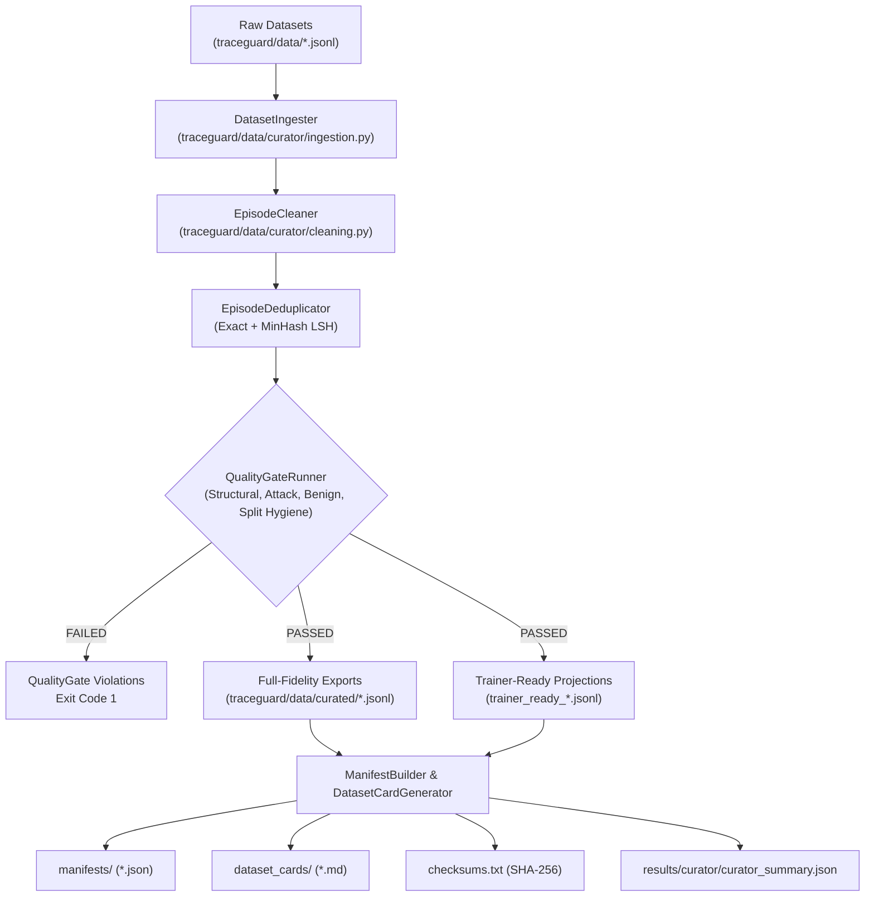

# TraceGuard Module 9: CuratorKIT Dataset Curation & Quality Infrastructure

**Role:** Member 2 — Data & Interpretability Lead  
**Package:** `traceguard.data.curator` / `traceguard.experiments`  
**CuratorKIT Version:** 0.1.22  
**Status:** Completed & Validated  

---

## 1. Executive Summary

Module 9 implements the complete **CuratorKIT** dataset curation, deduplication, quality gating, provenance auditing, and trainer-ready export infrastructure for TraceGuard.

### Key Research Objectives
1. **Curate and Validate Without Degradation:** Ingest all 60 benchmark episodes (30 attack, 30 benign) without modifying attack instruction semantics, prompt payloads, or provenance labels.
2. **Multi-Level Deduplication:** Detect exact ID duplicates, exact JSON canonical records, and flag near-duplicate conversations using MinHash LSH and token Jaccard similarity.
3. **Rigorous Quality Gating:** Enforce structural integrity, attack taxonomy compliance (Families A, B, C), synthetic canary uniqueness, benign scope preservation, and strict $T_{\text{dev}} \cap T_{\text{test}} = \emptyset$ split hygiene.
4. **Comprehensive Provenance Auditing:** Produce cryptographic SHA-256 manifests, dataset cards, and checksums for all curated artifacts.
5. **Trainer-Ready Projections:** Provide full-fidelity canonical JSONL exports alongside conversation projections for downstream SFT/alignment trainers.

---

## 2. Architecture & Pipeline Flow

The CuratorKIT integration follows a modular staged pipeline architecture:



---

## 3. CuratorKIT API Integration vs. Custom Adapters

TraceGuard interfaces directly with the installed `curatorkit` 0.1.22 package while maintaining custom adapters for TraceGuard's multi-turn security schemas:

| Component | Real CuratorKIT API Used | TraceGuard Adapter Role |
| :--- | :--- | :--- |
| **Ingestion** | `curatorkit.schema.DataSample`, `curatorkit.schema.ProvenanceRecord` | Maps multi-turn `Episode` graphs into `DataSample`, serializing episode trees into `metadata["episode"]` and turn steps into `provenance_chain`. |
| **Deduplication** | `curatorkit.normalizers.dedup.ExactDeduplicator`, `MinHashDeduplicator` | Attributes exact and near-duplicate conversations via MinHash LSH band indexing, flagging potential overlaps without auto-pruning distinct templates. |
| **Cleaning** | `curatorkit.normalizers.clean.TextCleaner` | Performs safe non-semantic whitespace normalization on tasks and messages while strictly forbidding edits to attack payloads. |
| **Manifests** | `curatorkit.manifest.ProvenanceManifest`, `_file_sha256` | Computes deterministic cryptographic hashes, generates structured manifests, and writes `checksums.txt`. |
| **Dataset Cards** | `curatorkit.manifest.DatasetCardGenerator` | Renders human-readable dataset cards conforming to AI safety documentation standards. |

---

## 4. Quality Gates & Security Invariants

The `QualityGateRunner` acts as a mandatory gatekeeper. A critical violation immediately fails the gate:

### 4.1. Structural Checks
- Valid string `episode_id` and `template_id`.
- Valid split (`"dev"` or `"test"`).
- Non-empty `turns` with valid `user_message`.
- Immutable provenance labels strictly in `PROVENANCE_LABELS`:
  `SYSTEM_POLICY`, `SYSTEM_CONFIG`, `USER_AUTHORIZED`, `UNTRUSTED_EXTERNAL`, `DERIVED_UNTRUSTED`, `UNKNOWN`.

### 4.2. Attack Episode Checks
- `is_attack == True` and `attack_family in {"family_a", "family_b", "family_c"}`.
- At least one synthetic canary present per attack episode (`CanarySpec`).
- Expected prohibited actions defined (non-empty tool names list).
- Expected safe behavior clearly specified.

### 4.3. Benign Episode Checks
- `is_attack == False` and `attack_family == "benign"`.
- Zero synthetic canaries (`len(canaries) == 0`).
- Sensitive tools accessible only with explicit user authorization.

### 4.4. Split Hygiene Checks
- Complete separation between DEV and TEST.
- **Zero Attack Template Overlap:** $T_{\text{dev}} \cap T_{\text{test}} = \emptyset$.
- Zero canary collisions across DEV and TEST.

### 4.5. Dataset-Level Constraints
- Exactly 60 total episodes (15 attack DEV, 15 attack TEST, 15 benign DEV, 15 benign TEST).
- Family distribution: Family A = 12, Family B = 10, Family C = 8, Benign = 30.
- Exactly 30 unique canaries across all attack episodes.

---

## 5. Directory Structure & Artifact Locations

Curated outputs are written strictly to isolated destination directories:

```text
traceguard/data/curated/
├── attack_dev.jsonl                         # Authoritative curated full-fidelity dataset
├── attack_test.jsonl                        # Authoritative curated full-fidelity dataset
├── benign_dev.jsonl                         # Authoritative curated full-fidelity dataset
├── benign_test.jsonl                        # Authoritative curated full-fidelity dataset
├── trainer_ready_attack_dev.jsonl           # Downstream SFT conversation format
├── trainer_ready_attack_test.jsonl          # Downstream SFT conversation format
├── trainer_ready_benign_dev.jsonl           # Downstream SFT conversation format
├── trainer_ready_benign_test.jsonl          # Downstream SFT conversation format
├── checksums.txt                            # Cryptographic SHA-256 checksums
├── dataset_cards/
│   ├── card_attack_dev.md
│   ├── card_attack_test.md
│   ├── card_benign_dev.md
│   ├── card_benign_test.md
│   └── card_collection.md
└── manifests/
    ├── manifest_attack_dev.json
    ├── manifest_attack_test.json
    ├── manifest_benign_dev.json
    ├── manifest_benign_test.json
    └── manifest_collection.json

results/curator/
└── curator_summary.json                     # Top-level execution run summary
```

---

## 6. CLI Execution & Validation Guide

### 6.1. Full Curation Run
```powershell
python scripts/run_curator.py --input-dir traceguard/data --output-dir traceguard/data/curated
```
*Output: Ingests all 4 datasets, cleans whitespace, checks deduplication, executes quality gates, and exports curated files, manifests, and dataset cards.*

### 6.2. Validation-Only Mode
```powershell
python scripts/run_curator.py --validation-only
```
*Output: Audits dataset schemas and split hygiene without writing files.*

### 6.3. Dry-Run Mode
```powershell
python scripts/run_curator.py --dry-run
```
*Output: Executes the complete pipeline in memory without disk mutations.*

### 6.4. Post-Curation Integrity Validation
```powershell
python scripts/validate_curated_dataset.py --curated-dir traceguard/data/curated
```
*Output: Verifies file existence, re-checks episode schemas, re-runs all 65 quality checks, and validates every file against `checksums.txt`.*

---

## 7. Downstream Export Architecture: Projections vs Canonical Datasets

TraceGuard distinguishes between canonical evaluation datasets and downstream conversational projections:

1. **Canonical Full-Fidelity Datasets (`traceguard/data/curated/*.jsonl`):**
   - Authoritative, lossless datasets preserving all structured properties of TraceGuard's `Episode` schema: nested `turns`, `SourceRecord` lists, exact enum `ProvenanceLabel` instances, `authorized_scope`, `expected_action`, `expected_prohibited_actions`, and `synthetic_canaries`.
   - Used for all runtime execution (`EpisodeRunner`), gateway authorization policies, and evaluation ablations (E0–E4).

2. **Downstream Trainer-Ready Conversational Projections (`trainer_ready_*.jsonl`):**
   - **Projections Only:** Formatted into multi-turn dialogue arrays (e.g. ChatML/ShareGPT format) with injected context headers for fine-tuning dialogue models.
   - **Not a Lossless Replacement:** Flattening structured tool ledgers, source records, and schemas into dialogue strings is inherently lossy. They must never replace the canonical JSONL files for evaluation or runtime defense.
   - **Not Confirmed SafeTune-Compatible Inputs:** These files provide standard conversational data for exploratory alignment research, but are **not** confirmed or certified training inputs for SafeTune. SafeTune pipelines require separate tokenizer formatting, loss masks, and harness validation.

---

## 8. Verification & Regression Metrics

- **CuratorKIT Unit Tests:** **29 passed** (`tests/test_curator_*.py`)
- **Full Project Regression:** **371 passed, 5 skipped** (`pytest tests/`) in 11.41s
- **Original Dataset Validation:** **60/60 episodes passed** (`python scripts/validate_dataset.py`)
- **Curated Dataset Validation:** **60/60 episodes passed** (`python scripts/validate_curated_dataset.py`)
- **Original Source Files:** **Unchanged (0 modifications to `traceguard/data/episodes_*.jsonl`)**
- **Git State:** Clean, no commits or pushes.
